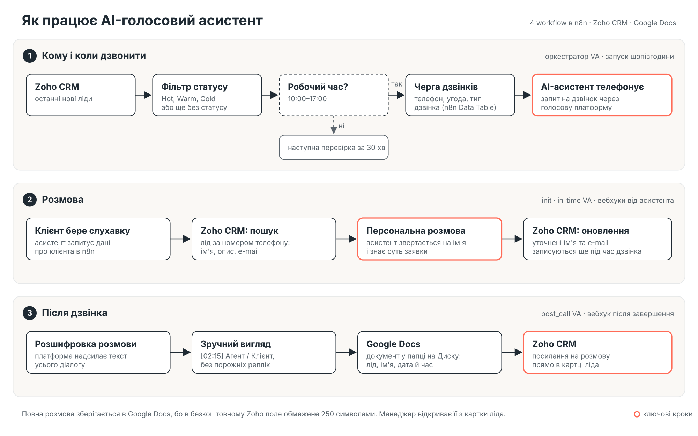
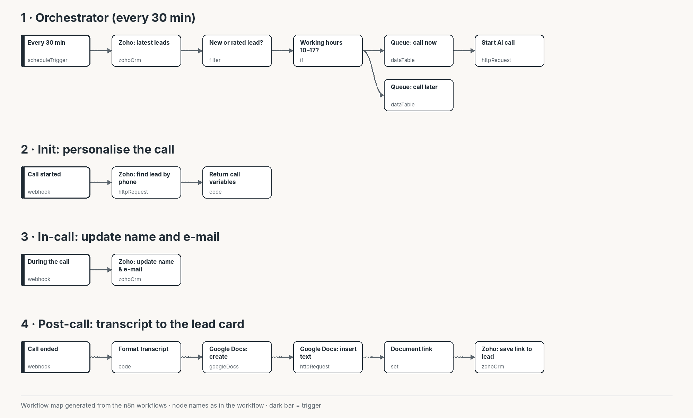

# AI Voice Bot: First Call to New Leads & CRM Update

**A new lead hears from you within the first half hour of working time: an AI voice assistant calls, personalizes the conversation from the CRM, corrects the contact details and saves the full transcript to the lead card.**

Demo project by Procesto, built and tested on test contacts in the CRM. Good fit for consulting, online schools and service businesses.

## The problem

> "The inquiry came in the evening, and the manager calls the next afternoon. By then the client has already talked to a competitor."

- New leads wait until a manager gets to them.
- The first call is postponed whenever something more urgent comes up.
- After the call, the CRM has a short note at best.
- Names and e-mails are often misspelled or missing.

## What the system does

1. **Every 30 minutes** the system checks the CRM for new leads.
2. **The AI assistant calls the new lead itself,** only during working hours.
3. **Personal from the first second.** When the call starts, the assistant looks up the caller's phone number in the CRM and gets the client's name and request.
4. **Clean data.** During the call the assistant confirms the name and e-mail and writes them to the lead card right away.
5. **Full transcript.** After the call, the conversation with speakers and timestamps is saved to a document, and the link goes to the lead card.

The client is told that they are speaking with an AI assistant, as required by the EU AI Act. The manager reads the transcript and joins where a person is needed.

## Before / after

|  | Before | After |
| --- | --- | --- |
| Who calls | a manager, when they can | the AI assistant, triggered by CRM status |
| When | postponed | during working hours, every 30 min |
| Call record | a short note or nothing | full transcript on the card |
| Client data | with errors or empty | confirmed during the call |

## Under the hood

Four n8n workflows around a voice AI platform (outbound calls via happ.tools):

- **Orchestrator:** Schedule (every 30 min) → Zoho leads → status filter → working-hours check → call queue in n8n Data Tables → start the call with the right assistant.
- **Init:** webhook at call start → find the lead in Zoho by phone → name, request and ID passed to the assistant as variables.
- **In-call:** webhook from the assistant → update the lead's name and e-mail in Zoho.
- **Post-call:** webhook with the transcript → dialogue formatted with timestamps → Google Doc → link in a custom lead field. The document holds the long text because the free CRM plan limits a field to 250 characters.

**Stack:** n8n · voice AI platform · Zoho CRM API · n8n Data Tables · Google Docs API · Webhooks · JavaScript

## Workflow map

Generated from the n8n workflows: every node and connection as built.

## Get the full workflow

The workflow files and assistant scripts are not published. To hear a demo call, or to get it set up for your CRM and your call script:

→ **[Fill in a short brief](https://tally.so/r/J1lLxK?utm_source=github&utm_medium=repo&utm_campaign=portfolio&utm_content=ai-voice-first-call)** · [Full case study](https://super-kettle-5ea.notion.site/41d396519ffa819b8289f7d27dd4be89) · [procesto.eu](https://procesto.eu)

---

© 2026 Procesto. All rights reserved.
